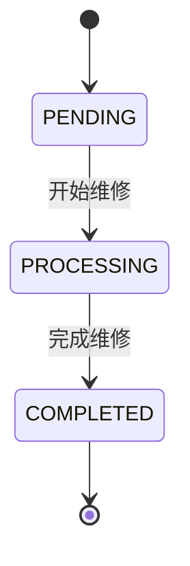
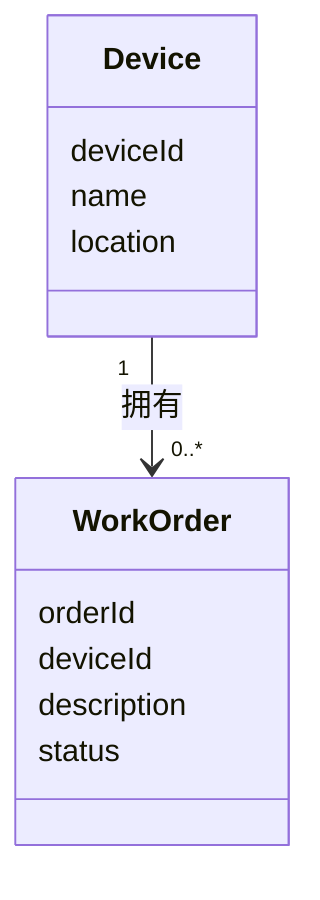

# 状态图与简单类图

## 状态图
工单创建后进入 PENDING（待处理）。仅允许两个事件：
- 开始维修：PENDING → PROCESSING
- 完成维修：PROCESSING → COMPLETED

COMPLETED 为本次业务终态，不增加重新打开、取消、跳过处理中等状态。

中文与英文对应：待处理 PENDING、处理中 PROCESSING、已完成 COMPLETED。
简单类图
Device 表示设备，属性：deviceId、name、location。
WorkOrder 表示工单，属性：orderId、deviceId、description、status。
一台设备对应 0 到多张工单，每张工单必须对应 1 台设备。

与需求的一致性检查
☑ 中文状态与程序英文值对应
☑ 只允许两条转换
☑ 一台设备与多张工单关系清楚
模型补充说明
1.状态图说明：本实验的工单生命周期严格限制为单向流转（PENDING -> PROCESSING -> COMPLETED）。拒绝回退，也拒绝跳级。
2.类图关系说明：Device（设备）与 WorkOrder（工单）是 1 对 0..* 的关系。
